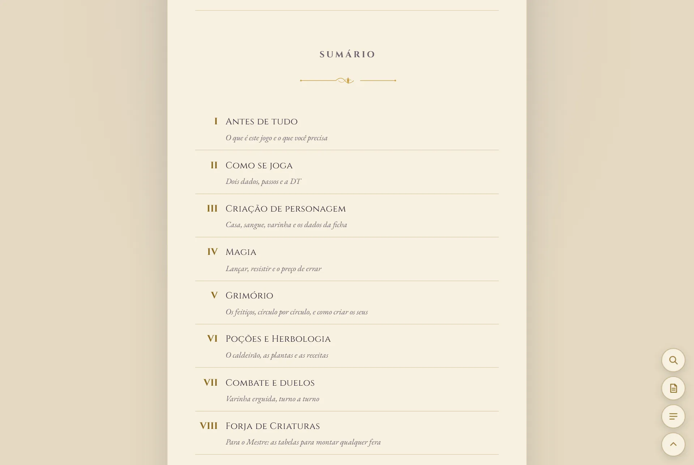
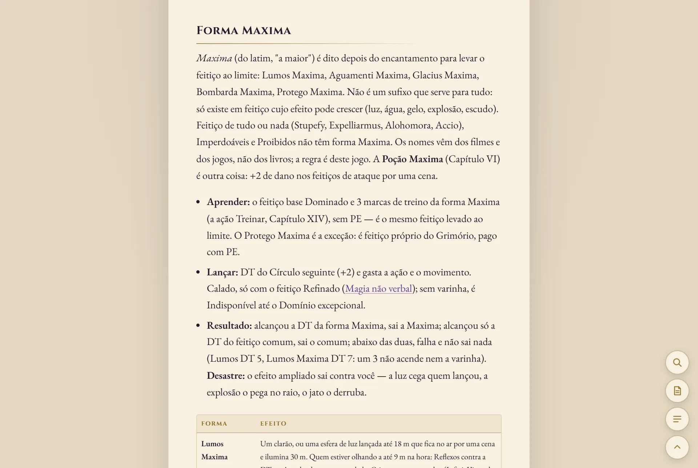
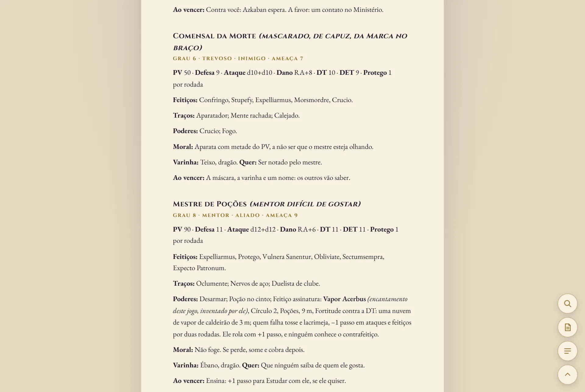
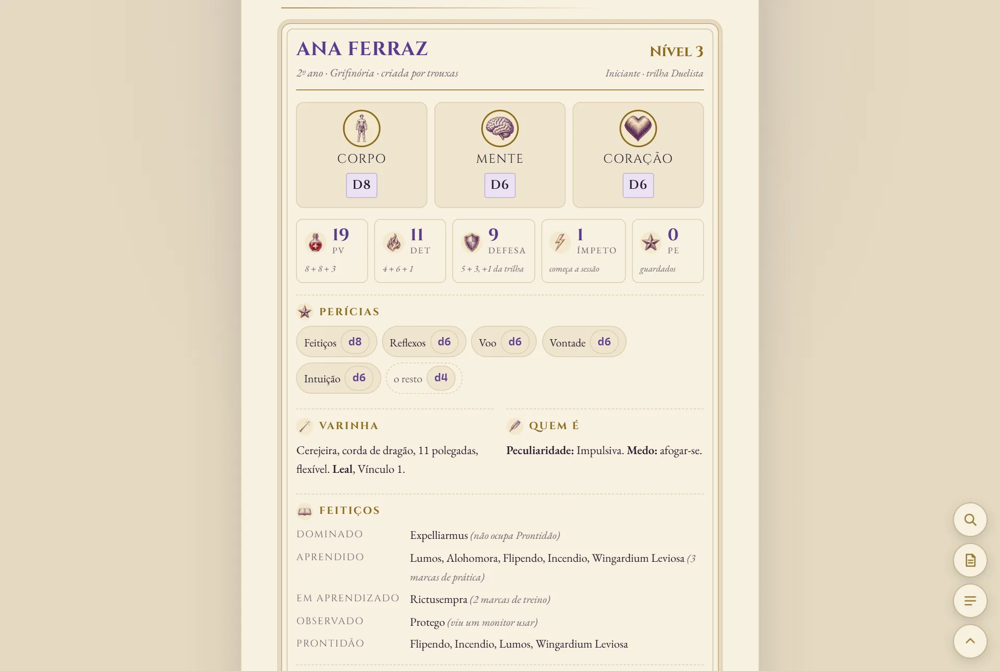
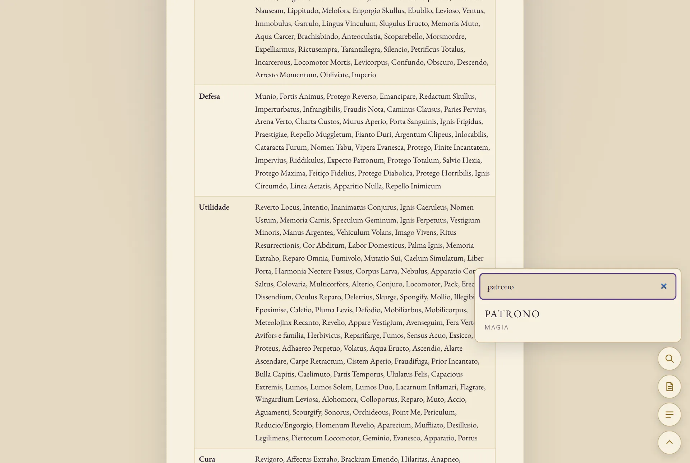
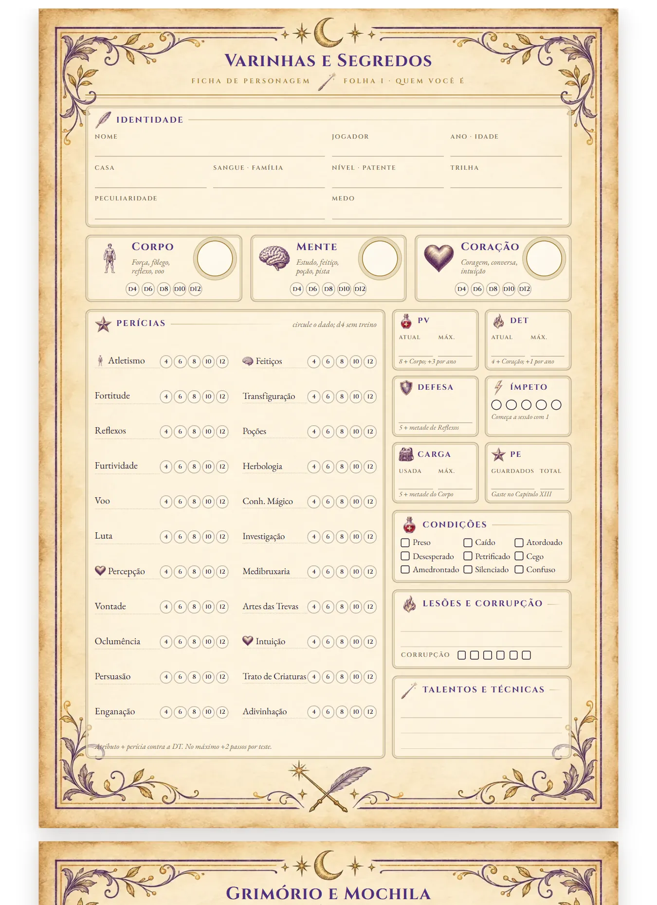
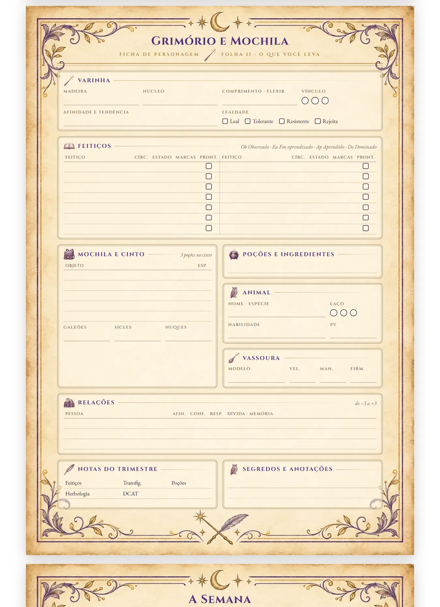
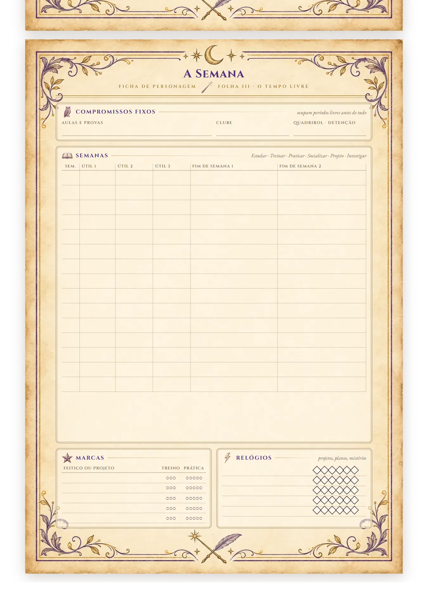
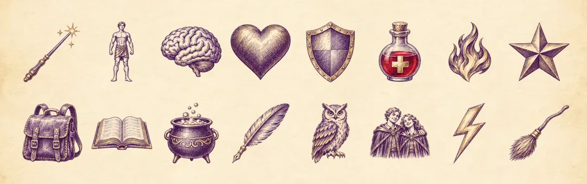

<div align="center">

# Varinhas e Segredos

**Um RPG de mesa no mundo bruxo de Hogwarts, inteiro num só livro HTML.**

[**Ler o livro**](https://madeiragab.github.io/varinhas-e-segredos/) ·
[**Ficha para imprimir**](https://madeiragab.github.io/varinhas-e-segredos/ficha.html) ·
versão 1.0 RC


</div>

---

## O que é

Os jogadores fazem alunos de Hogwarts, do 1º ao 7º ano. O livro tem tudo de que a
mesa precisa: as regras, a magia, o combate, o bestiário, a vida na escola entre as
aulas e as ferramentas do Mestre. Tudo fica num arquivo só, que abre no navegador,
funciona offline e sai bem na impressão.

O motor é próprio. Cada atributo e cada perícia é um dado (d4 a d12) que sobe de
passo com o tempo. Não há mana: a magia gasta Determinação e corre o risco de
Desastre.

| | |
|---|---|
| Capítulos | 17 (I a XVI e o apêndice), em três partes |
| Feitiços no Grimório | cerca de 300, com Círculo, custo e efeito |
| Criaturas | 91 fichas de bestiário e 10 bruxos prontos |
| Itens | 204, além de 35 vassouras, 21 núcleos e 41 madeiras de varinha |
| Poções | 72 receitas com modo de preparo |
| Tabelas | 205 |
| Texto | cerca de 88 mil palavras |

## Por dentro

<table>
<tr>
<td width="50%"><br><sub><b>Sumário.</b> Três partes (jogadores, Mestre, campanha) e o apêndice.</sub></td>
<td width="50%"><br><sub><b>Grimório.</b> Cada feitiço tem Círculo, custo, alcance e o que muda com o crítico.</sub></td>
</tr>
<tr>
<td><br><sub><b>Forja de Bruxos.</b> Bruxos inimigos e aliados saem do Grau e do Papel. Também há cartões prontos.</sub></td>
<td><br><sub><b>Exemplo de ficha.</b> Uma aluna do 2º ano montada passo a passo no apêndice.</sub></td>
</tr>
<tr>
<td colspan="2"><br><sub><b>Navegação.</b> Os botões flutuantes abrem a busca (<code>/</code>), o sumário, a ficha e a volta ao topo. A busca indexa títulos e a primeira coluna das tabelas.</sub></td>
</tr>
</table>

### Os capítulos

| Parte | Capítulos |
|---|---|
| **Para os jogadores** | I Antes de tudo · II Como se joga · III Criação de personagem · IV Magia · V Grimório · VI Poções e Herbologia · VII Combate e duelos |
| **Para o Mestre** | VIII Forja de Criaturas · IX Bestiário · X Aliados e NPCs · XI Varinhas, itens e artefatos · XII O mundo e as aventuras |
| **A campanha** | XIII Evolução e exames · XIV A vida em Hogwarts · XV O mundo que anda · XVI Magizoologia, materiais e fabricação |
| **Apêndice** | Probabilidades, exemplos de jogo e glossário |

## A ficha de personagem

[`ficha.html`](ficha.html) imprime três folhas A4 sobre pergaminho:

1. **Identidade:** atributos, perícias, PV, DET, Defesa, condições, lesões e talentos.
2. **Equipamento:** varinha, feitiços, mochila, poções, animal, vassoura, relações e segredos.
3. **A semana:** compromissos, a grade de períodos, as marcas de prática e os relógios.

<p align="center">



</p>

Para imprimir, abra a ficha no navegador e use Ctrl+P com o papel em A4, sem margens e
com os gráficos de fundo ligados. Os ícones e o pergaminho foram gerados com o GPT
Image e tratados para a página:

<p align="center"></p>

---

## Arquitetura

O site é estático e não tem framework nem dependência de execução. O livro é escrito
em pedaços e montado num HTML único por um script de 20 linhas.

```
template/
├── livro.html            esqueleto: capa, sumário, navegação e busca (JS próprio)
├── livro.css             tema claro/escuro, tabelas, cartões, impressão
└── capitulos/
    ├── 01-03-regras.html     I a III
    ├── 04-07-magia.html      IV a VII
    ├── 08-13-mestre.html     VIII a XII
    ├── 13-evolucao.html      XIII
    ├── 14-vida.html          XIV
    ├── 15-mundo.html         XV
    ├── 16-materiais.html     XVI
    └── 99-apendice.html      apêndice
        │
        ▼  python build.py
index.html   ← gerado, ~780 KB, com CSS embutido (é o que o GitHub Pages serve)
ficha.html   ← folha de personagem, página separada
assets/      ← capas e aberturas de parte (webp), fontes woff2, ícones da ficha
tests/
├── auditoria.py          confere o livro gerado contra as regras
└── simulacoes.py         Monte Carlo do equilíbrio
docs/img/                 capturas deste README
```

`build.py` faz quatro coisas:

1. Junta os capítulos em ordem alfabética, por isso os prefixos numéricos.
2. Substitui `{{CSS}}`, `{{CAPITULOS}}`, `{{VERSAO}}` e `{{DATA}}`.
3. Escreve `index.html`.
4. **Para com erro** se sobrar algum placeholder ou se algum `href="#…"` apontar para um
   `id` que não existe. Um link interno quebrado não chega ao site.

```bash
python build.py                                  # gera index.html
PYTHONIOENCODING=utf-8 python tests/auditoria.py # 112 conferências, deve dar 0 falhas
python tests/simulacoes.py                       # tudo; ou: poções | quadribol | combate | bruxos | evolução
python tests/publicacao.py                       # depois do push: o site no ar é este build?
python -m http.server 8765                       # abre em http://localhost:8765
```

### Testes

O livro é grande demais para conferir no olho, então ele tem testes como código.

- **`auditoria.py`** lê o `index.html` final e verifica:
  - se toda ficha de criatura e todo cartão de bruxo bate com a Tábua de Perigo e com o
    Papel declarado (os números são recalculados a partir dos atributos `data-*` de cada
    cartão);
  - se os feitiços respeitam os limites de Círculo e custo;
  - se as tabelas de itens, vassouras e varinhas estão completas;
  - se o texto não usa termos proibidos;
  - se dezenas de **frases de regressão** continuam lá. Cada regra corrigida numa revisão
    vira uma frase que o teste exige, e assim a correção não volta atrás em silêncio.
- **`simulacoes.py`** joga milhares de rodadas com semente fixa (1504):
  - chance de sucesso de cada DT por dado;
  - partidas de Quadribol;
  - lutas de 4 alunos contra cada criatura e cada bruxo pronto, com e sem aliado;
  - combinações perigosas: Comandante com ação extra, curandeiras em fila, chefe
    acompanhado;
  - a curva de evolução ao longo dos sete anos;
  - quanto uma vassoura melhor muda o Quadribol.
- **`publicacao.py`** compara a assinatura do build (`<meta name="build">`) do
  `index.html` local com a do site no ar, para ninguém revisar uma versão velha.

---

## Decisões de design

**Um livro só, em HTML.** Um PDF não tem busca boa nem tema escuro e pesa no celular.
Um site de várias páginas espalha a leitura. O HTML único abre em qualquer lugar, pode
ser salvo e lido offline, imprime com quebras de página pensadas e deixa o Ctrl+F do
navegador funcionar. A busca própria e o sumário fixo resolvem a navegação num documento
longo.

**Dados que sobem de passo, sem mana.** Um aluno do 1º ano e um do 7º usam o mesmo
sistema. O que muda é o tamanho do dado. A magia custa Determinação, que também segura o
medo e a dor, então lançar feitiços compete com aguentar a cena. Não há uma barra
separada só para "poder mágico".

**Combate em três fases, sem iniciativa.** Preparo, Feitiços e Corpo a corpo: todos
declaram e resolvem por fase. Isso evita a espera do "agora é a vez de quem?", e o duelo
de varinhas tem o ritmo dos livros. Cada lado ganha no máximo uma ação extra por rodada,
seja qual for a fonte, porque a simulação mostrou que empilhar ações quebrava qualquer
luta.

**Uma Tábua de Perigo para tudo.** Criaturas e bruxos saem da mesma tabela (Grau 1 a
11), então o Mestre monta um inimigo em um minuto e sabe quanto ele pesa. O **Papel**
(Duelista, Curandeiro, Trevoso…) só ajusta os números com um multiplicador. Traços e
poderes fortes custam Ameaça, e o orçamento da cena continua honesto.

**NPCs seguem as regras dos personagens.** Um aliado que luta cai, sangra e morre como
um aluno, e custa orçamento como um inimigo. Um bruxo das trevas só usa Crucio se o Grau
dele permitiria isso a um personagem. O Mestre não ganha exceções escondidas.

**Itens genéricos, lojas abertas.** O livro descreve *tipos* de objeto (uma capa de
invisibilidade comum, um vira-tempo) e não os objetos de personagens dos livros. O que
cada loja do Beco Diagonal tem no estoque fica com o Mestre. Assim a campanha não fica
presa ao cânone e cada mesa monta o seu mundo.

**Feitiços inventados são marcados.** Quando o jogo precisa de um feitiço que não existe
nos livros, ele aparece como *"Nome (encantamento deste jogo)"*. O jogador sempre sabe o
que é cânone e o que é da casa.

**A semana é um recurso.** Aulas, treino de Quadribol, detenções, clubes e estudo
disputam os mesmos períodos. É por isso que a ficha tem uma terceira folha: a vida em
Hogwarts entre as aventuras é metade do jogo.

**Leve e offline.** As imagens são webp em dois tamanhos (`srcset`) e as fontes (Cinzel e
EB Garamond) são woff2 servidas pelo próprio repositório. Não há CDN nem script de
terceiros, e as imagens fora da tela carregam com `loading="lazy"`.

**Medir em vez de confiar.** Cada mudança de número passa pela auditoria e pela
simulação antes de entrar no livro. O equilíbrio do bestiário, da Forja de Bruxos e da
evolução foi ajustado com o que as simulações mostraram, e não por intuição.

## Arte

- **Capa, contracapa e aberturas de parte:** ilustrações geradas por IA e convertidas
  para webp em 640/768 e 1024 px.
- **Ícones e pergaminho da ficha:** gerados com o GPT Image numa grade 4×4 em estilo de
  gravura. Cada ícone foi recortado com transparência tirada da luminância e reduzido a
  160 px. O pergaminho ornamentado é o fundo das três folhas.

## Estado

**1.0 RC.** As regras estão completas e auditadas, e o equilíbrio foi simulado. Falta o
teste de mesa com jogadores reais, que pode mexer em números antes da 1.0.

---

<sub>Projeto de fã, sem fins lucrativos. Harry Potter e o mundo bruxo pertencem a J.K. Rowling e à Warner Bros.; este livro não tem ligação com eles.</sub>
